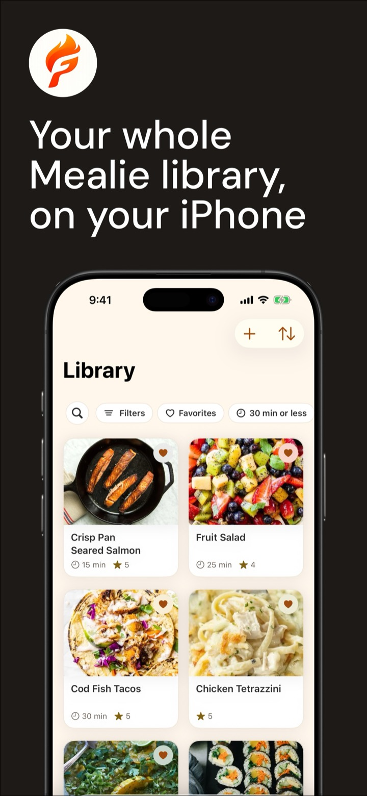
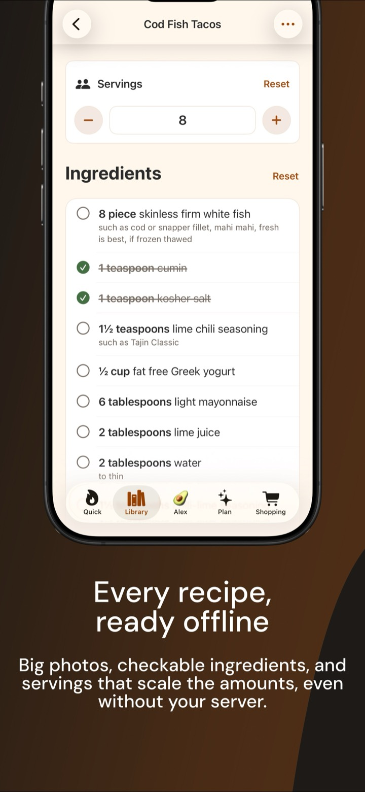
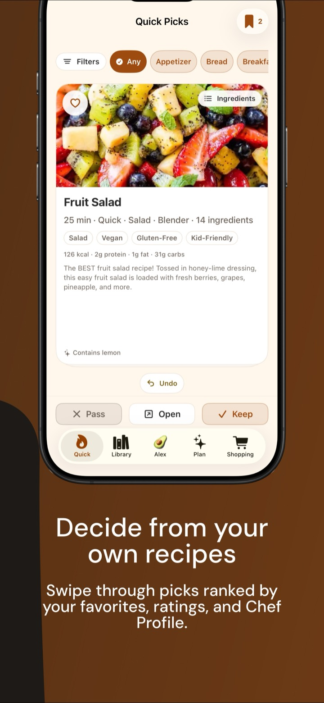
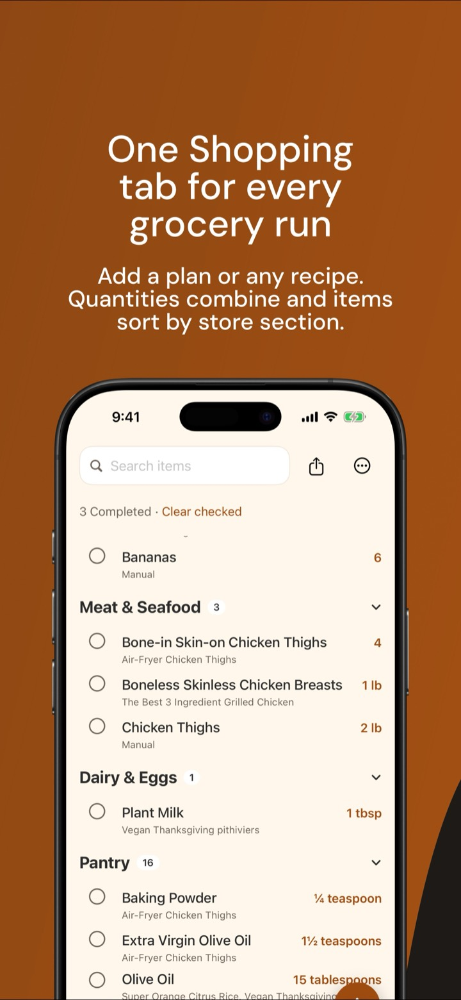
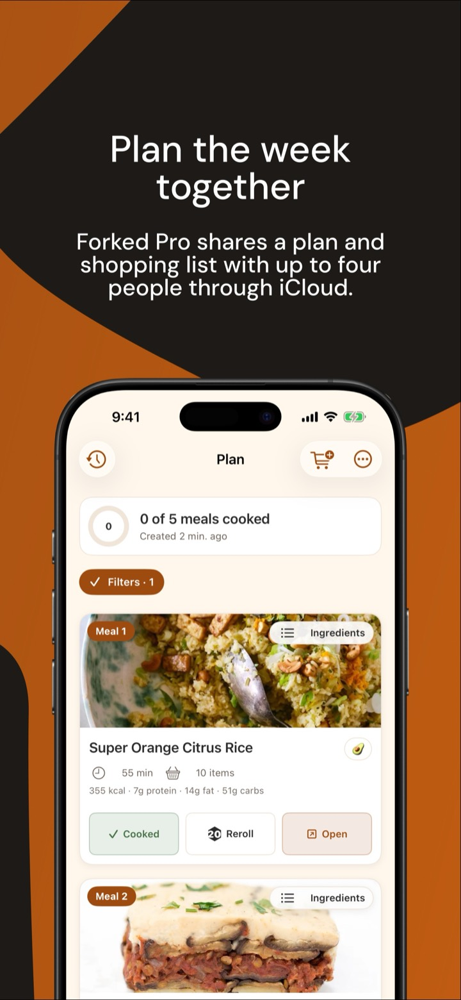

# Forked for Mealie

**Forked is closed source.** This repository holds Forked's public docs,
[roadmap](ROADMAP.md), [changelog](CHANGELOG.md), and
[issue tracker](https://github.com/Knownframe/forked-for-mealie/issues). The
app's code is not here.

Forked ("Forked Recipes" on the App Store) is an iPhone app for your
self-hosted [Mealie](https://mealie.io) recipe library. Browse and edit
recipes, decide what to cook, plan the week, and shop from one list. Your
recipes stay on your own server. There is no Forked account, no ads, and no
tracking.

  

  
  
  
  
  

## What Forked does

The current release is 2026.10.1.

- **Your whole library.** Every recipe as a photo card, with search across
  titles, ingredients, steps, and notes, and filters for favorites, rating,
  cook time, tags, and categories. Recipes are saved for reading offline, with
  servings that scale the amounts.
- **Edit, favorite, and rate.** Change recipes, add new ones, and replace
  photos from your iPhone. Edits save to your Mealie server and wait safely
  while you're offline. If a recipe changed on the server while you were
  editing, Forked shows both versions and lets you choose.
- **Decide what to cook.** Swipe through Quick Picks from your own recipes,
  ranked by your favorites, ratings, and Chef Profile.
- **Plan the week.** Generate a multi-day plan from your library, swap any
  meal, and add any recipe straight from the Library.
- **One grocery list.** Add a plan, saved picks, or your own items to one
  Shopping list. Matching quantities combine, items sort by store section, and
  you can share the list.
- **Cook step by step.** One step at a time, with built-in timers, and the
  screen stays on while you cook.
- **Chef Profiles.** Record allergies, diets such as vegan, halal, and
  gluten-free, and the ingredients you love or avoid. Filtering is based on
  ingredient names and tags and cannot guarantee allergen safety: always check
  ingredients and labels.
- **Works when your server doesn't.** After your first sync, saved recipes,
  plans, Quick Picks, and Shopping stay ready while your server is slow or
  unreachable.
- **Built for everyone.** VoiceOver, Voice Control, Larger Text, Reduce
  Motion, status that doesn't rely on color, and light and dark appearance.

### Free and Forked Pro

Browsing, editing, Quick Picks, meal plans, Shopping, and cooking are free.
Forked Pro is a one-time purchase, shareable with Family Sharing. It adds
Households (share a meal plan and shopping list with up to four people through
iCloud; joining is free), Plan History, Use This Plan Again, Reuse Ingredients,
and Avoid Recent Meals. There are no subscriptions. Optional tips unlock
nothing.

## Requirements and compatibility

- An iPhone with iOS 17 or later.
- A self-hosted Mealie server, served at the root of a hostname or IP address
  (with an optional port). Mealie under a path such as
  `https://example.com/mealie` is not supported.
- Editing, adding, and deleting recipes, replacing photos, favorites, ratings,
  and Last Made need **Mealie 3.21 or later**. On older servers, Forked reads
  your library but doesn't change it.
- Sign in with your Mealie username and password (Forked creates an API token
  for itself and never stores the password), or paste an API token.

### Connecting

- Forked tries HTTPS first. **Remote servers need HTTPS** with a certificate
  your iPhone trusts.
- **Plain HTTP works only on your own network:** private IP addresses,
  `localhost`, and `.local` names.
- Self-signed and `mkcert` certificates on your own network can be trusted
  under Connection Options.
- **Sign-in proxies:** behind Cloudflare Access (with a service token) or
  Pangolin (header authentication), add your proxy's request headers under
  Connection Options. Forked keeps them in your iPhone's Keychain and sends
  them only to your server.
- Known-good setups include direct LAN access, Tailscale with HTTPS, Caddy or
  Traefik at a dedicated hostname, and Cloudflare Tunnel. A browser login wall
  (for example Authentik forward-auth) in front of Mealie's API doesn't work
  unless it accepts headers Forked can send.

The [support page](https://knownframe.com/support/forked/) has the details for
reverse proxies, Tailscale, and troubleshooting.

## Feedback

- **Something not working?** Check the [known issues](KNOWN_ISSUES.md) first.
- **Found a bug?** [Open a bug report](https://github.com/Knownframe/forked-for-mealie/issues/new?template=bug_report.yml).
- **Want a feature?** Search the
  [open requests](https://github.com/Knownframe/forked-for-mealie/issues?q=is%3Aissue+is%3Aopen+label%3Aenhancement)
  and add a 👍 to the ones you want. A 👍 counts for more than a "+1" comment.
  If yours isn't there, [request it](https://github.com/Knownframe/forked-for-mealie/issues/new?template=feature_request.yml).
- **Need help with setup?** See the
  [support page](https://knownframe.com/support/forked/) or email
  support@knownframe.com.

Issues here are public. **Never post your server address, API tokens,
passwords, or request header values.** If a problem needs logs, use **Profile
→ Settings → About → Report a Bug** in the app instead: it opens an email you
can review before sending, with tokens and server addresses redacted.

## Links

- [Forked website](https://knownframe.com/forked/)
- [Support](https://knownframe.com/support/forked/)
- [Privacy policy](https://knownframe.com/privacy/forked/)
- [Roadmap](ROADMAP.md), [changelog](CHANGELOG.md), and
  [known issues](KNOWN_ISSUES.md)

---

Forked is made by [Knownframe](https://knownframe.com). Forked is an
independent app and is not affiliated with or endorsed by the Mealie project.

Apple, the Apple logo, and iPhone are trademarks of Apple Inc., registered in
the U.S. and other countries and regions. App Store is a service mark of Apple
Inc.
